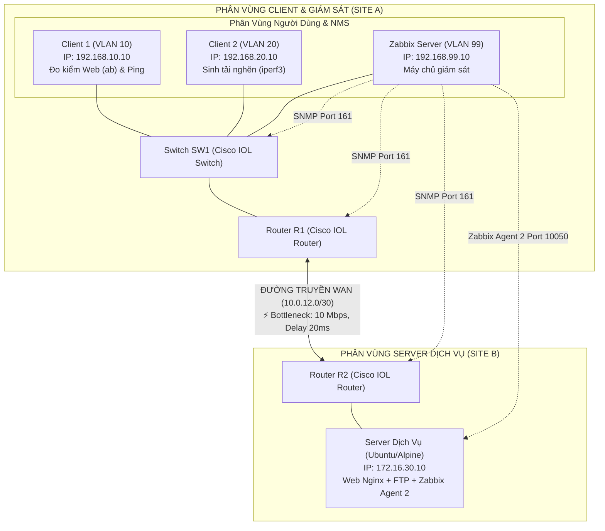

> [!IMPORTANT]
> **TÀI LIỆU HƯỚNG DẪN & KẾ HOẠCH TRIỂN KHAI ĐỒ ÁN NHÓM (BẢN ĐƠN GIẢN HÓA & TINH GỌN)**
> Học phần: **Đánh giá hiệu năng mạng** (Bậc Đại học - Sinh viên năm 3 - Nhóm 6 thành viên).
> Định hướng: Giảm tải độ phức tạp kỹ thuật, tập trung vào tính trực quan, độ ổn định khi demo và giữ trọn vẹn mục tiêu học thuật môn học.

---

# HỆ THỐNG MẠNG DOANH NGHIỆP & ĐÁNH GIÁ HIỆU NĂNG MẠNG VỚI ZABBIX

> **Môn học / Đồ án:** Đánh giá hiệu năng mạng  
> **Đề tài:** Xây dựng mô hình mạng doanh nghiệp trên PnetLab, sinh lưu lượng đa dịch vụ và đánh giá hiệu năng mạng bằng Zabbix  
> **Nền tảng kỹ thuật:** PnetLab (Cisco IOL, Ubuntu/Alpine Linux), Định tuyến OSPF / Static, 802.1Q VLAN, SNMPv2c, Zabbix 6.x/7.x & Zabbix Agent 2, iperf3, Apache Bench (`ab`), ping/fping, QoS Cisco (Class-Map / Policy-Map) hoặc Linux `tc` (TBF).

---

## 📑 MỤC LỤC
1. [Tổng Quan Đề Tài & Mục Tiêu Nghiên Cứu](#1-tổng-quan-đề-tài--mục-tiêu-nghiên-cứu)
2. [Mô Hình Kiến Trúc & Sơ Đồ Topology Tinh Gọn](#2-mô-hình-kiến-trúc--sơ-đồ-topology-tinh-gọn)
3. [Quy Hoạch Phân Vùng Mạng (VLAN & IP Addressing)](#3-quy-hoạch-phân-vùng-mạng-vlan--ip-addressing)
4. [Phân Chia Nhiệm Vụ 6 Thành Viên Theo Năng Lực](#4-phân-chia-nhiệm-vụ-6-thành-viên-theo-năng-lực)
5. [Ma Trận Trách Nhiệm (RACI Matrix)](#5-ma-trận-trách-nhiệm-raci-matrix)
6. [Kịch Bản Đo Kiểm & Phương Án Demo Bảo Vệ Đồ Án](#6-kịch-bản-đo-kiểm--phương-án-demo-bảo-vệ-đồ-án)
7. [Khung Đề Cương Báo Cáo Học Phần 5 Chương](#7-khung-đề-cương-báo-cáo-học-phần-5-chương)

---

## 1. TỔNG QUAN ĐỀ TÀI & MỤC TIÊU NGHIÊN CỨU

Trong môi trường mạng doanh nghiệp vừa và nhỏ, đường truyền kết nối giữa các chi nhánh hoặc ra ngoài Internet thường có băng thông giới hạn. Khi các luồng tải nặng (như tải file dung lượng lớn, sao lưu dữ liệu) diễn ra đồng thời với các dịch vụ nghiệp vụ (Web nội bộ, quản trị), hệ thống sẽ xảy ra hiện tượng nghẽn mạng (Network Congestion), làm tăng độ trễ và gián đoạn dịch vụ.

**Các luồng lưu lượng chính trong đồ án:**
* **Lưu lượng ứng dụng Web (HTTP - Port 80):** Dịch vụ nghiệp vụ quan trọng, yêu cầu thời gian đáp ứng nhanh (Low Latency).
* **Lưu lượng tải nặng (iperf3 / FTP - Port 5201 / 21):** Chiếm dụng băng thông lớn, dễ gây nghẽn tại nút thắt cổ chai đường truyền (Bottleneck).
* **Lưu lượng giám sát & kiểm tra (SNMP Port 161, Zabbix Agent Port 10050, ICMP Ping):** Đo lường liên tục các thông số hiệu năng của thiết bị và đường truyền.

**Mục tiêu cốt lõi của đồ án:**
1. Xây dựng thành công mô hình mạng ảo hóa trên **PnetLab** kết nối giữa 2 phân vùng mạng qua liên kết WAN có giới hạn băng thông.
2. Giám sát tự động và trực quan hóa các chỉ số hiệu năng (Throughput, Latency, Packet Loss, CPU/RAM Server) bằng **Zabbix**.
3. Thực hiện kịch bản sinh tải thực nghiệm: đo đạc đối chứng ở 3 trạng thái: **Bình thường (Baseline)** $\rightarrow$ **Nghẽn mạng (Stress Test)** $\rightarrow$ **Áp dụng QoS (Optimized)**.
4. Chứng minh bằng số liệu và biểu đồ rõ ràng: **"Mạng có áp dụng QoS mang lại hiệu năng và độ ổn định tốt hơn rõ rệt so với khi không có QoS"**.

> 💡 **Ghi chú đơn giản hóa:**
> * Rút gọn phạm vi dịch vụ từ 3 xuống 2 dịch vụ chính (Web + FTP), bỏ DNS riêng để tránh lỗi phân giải tên miền khi demo.
> * Tập trung làm rõ bài toán: *Quá tải băng thông gây suy giảm dịch vụ và cách giải quyết bằng QoS*.

---

## 2. MÔ HÌNH KIẾN TRÚC & SƠ ĐỒ TOPOLOGY TINH GỌN

Mô hình được tối ưu tối đa về tài nguyên (Tổng dung lượng RAM lab chỉ khoảng **4GB – 5.5GB**, hoạt động mượt mà trên laptop sinh viên):

```text
========================================================================================================================
                                     SƠ ĐỒ TOPOLOGY MẠNG & LUỒNG ĐO KIỂM TINH GỌN
========================================================================================================================

   PHÂN VÙNG CLIENT & GIÁM SÁT (SITE A)                                                  PHÂN VÙNG SERVER (SITE B)
  ┌────────────────────────────────────────────────────────┐                              ┌─────────────────────────────┐
  │ [VLAN 10: 192.168.10.0/24]                             │                              │ [VLAN 30: 172.16.30.0/24]   │
  │  💻 Client 1 (192.168.10.10)                           │                              │  🏢 Server Dịch Vụ          │
  │     └─ Đo kiểm Web (ab), Ping RTT                      │                              │     IP: 172.16.30.10        │
  │                                                        │                              │     ├─ Nginx Web (Port 80)  │
  │ [VLAN 20: 192.168.20.0/24]                             │                              │     ├─ vsftpd FTP (Port 21) │
  │  💻 Client 2 (192.168.20.10)                           │                              │     └─ Zabbix Agent 2       │
  │     └─ Sinh tải nghẽn (iperf3 UDP/TCP)                 │                              │        (Port 10050)         │
  │                                                        │                              └──────────────┬──────────────┘
  │ [VLAN 99: 192.168.99.0/24]                             │                                             │
  │  🖥️ Zabbix Server (192.168.99.10)                      │                                             │
  │     └─ Máy chủ giám sát (SNMP Polling, Agent 2, Ping)  │                                             │
  └────────────────────────┬───────────────────────────────┘                                             │
                           │ (VLAN Trunking / Access 802.1Q)                                             │
  ┌────────────────────────┴───────────────────────────────┐                                             │
  │ 🔀 Switch SW1 (Cisco IOL Switch - Phân tách VLAN)     │                                             │
  └────────────────────────┬───────────────────────────────┘                                             │
                           │ (Trunk 802.1Q)                                                              │
  ┌────────────────────────┴───────────────────────────────┐                              ┌──────────────┴──────────────┐
  │ 🌐 Router R1 (Gateway Site A - Cisco IOL)              │  ĐƯỜNG TRUYỀN WAN (OSPF/IP)  │ 🌐 Router R2 (Gateway Site B)│
  │    IP: 10.0.12.1 / Sub-IF: .10, .20, .99               │◄════════════════════════════►│    IP: 10.0.12.2 / .30.1    │
  └────────────────────────────────────────────────────────┘ ⚡ BOTTLENECK: 10 Mbps, 20ms └─────────────────────────────┘
                                                               (PnetLab Link Quality)

  ──────────────────────────────────────────────────────────────────────────────────────────────────────────────────────
  📊 CÁC LUỒNG GIÁM SÁT ZABBIX (NMS):
     • [SNMPv2c Polling - Port 161]         : Zabbix Server ──► Router R1, Router R2, Switch SW1 (CPU, RAM, Traffic IF)
     • [Zabbix Agent 2 - Port 10050]        : Zabbix Server ──► Server Dịch Vụ (Web Nginx, CPU, RAM, System Metrics)
     • [ICMP Ping Polling / fping]          : Zabbix Server ──► R1, R2, Server Dịch Vụ (Đo Latency RTT, Packet Loss)
========================================================================================================================
```

<details>
<summary><b>📐 Xem mã nguồn sơ đồ dạng Mermaid (Click để mở)</b></summary>



</details>

> [!IMPORTANT]
> **THIẾT LẬP ĐIỂM NGHẼN (BOTTLENECK) CHUẨN XÁC VÀ DỄ DÀNG:**
> * Không cần cấu hình các kỹ thuật can thiệp phức tạp ở tầng Linux kernel trên từng máy client.
> * **Giải pháp chuẩn xác & đơn giản:** Tận dụng tính năng **Link Quality** trực tiếp trên đường nối ảo giữa R1 và R2 trong giao diện PnetLab:
>   * *Click chuột phải vào đường nối giữa R1 và R2 $\rightarrow$ Edit:*
>   * Thiết lập: **Bandwidth: 10 Mbps**, **Delay: 20 ms**, **Loss: 0%**.
> * Cơ chế này tự động can thiệp vào tầng ảo hóa của PnetLab, đảm bảo mọi lưu lượng vượt quá 10 Mbps chạy qua liên kết R1-R2 sẽ bị xếp hàng và gây nghẽn thực tế 100%.

> 💡 **Ghi chú đơn giản hóa:**
> * Topology chỉ gồm: **2 Router + 1 Switch + 1 Server Dịch Vụ + 1 Zabbix Server + 2 Client** (tổng 7 nodes ảo nhẹ, tiêu thụ ~4.5GB RAM).
> * Bỏ bớt các node rườm rà ở phía Server, tập trung đường truyền đo kiểm qua một nút thắt duy nhất (R1-R2).

---

## 3. QUY HOẠCH PHÂN VÙNG MẠNG (VLAN & IP ADDRESSING)

| Phân Vùng Mạng | VLAN ID | Địa Chỉ Mạng (CIDR) | Default Gateway | Thiết Bị & Vai Trò Trong Đồ Án |
| :--- | :---: | :--- | :--- | :--- |
| **Quản Trị Giám Sát (NMS)** | VLAN 99 | `192.168.99.0/24` | `192.168.99.1` | **Zabbix Server** (`.10`): Giám sát SNMP thiết bị mạng và Agent máy chủ |
| **Người Dùng 1 (Đo Web/Ping)** | VLAN 10 | `192.168.10.0/24` | `192.168.10.1` | **Client 1** (`.10`): Sinh tải Web (`ab`), gửi gói tin ICMP ping đo độ trễ |
| **Người Dùng 2 (Sinh Tải Nghẽn)** | VLAN 20 | `192.168.20.0/24` | `192.168.20.1` | **Client 2** (`.10`): Bắn luồng lưu lượng lớn (`iperf3` 15-20 Mbps) gây nghẽn WAN |
| **Khu Vực Server (Site B)** | VLAN 30 | `172.16.30.0/24` | `172.16.30.1` | **Server Dịch Vụ** (`.10`): Web Nginx + FTP vsftpd + Zabbix Agent 2 |
| **Liên Kết WAN R1 - R2** | N/A | `10.0.12.0/30` | N/A | Đường truyền định tuyến OSPF/Static. Giới hạn **10 Mbps, Delay 20ms** bằng PnetLab Link Quality |

---

## 4. PHÂN CHIA NHIỆM VỤ 6 THÀNH VIÊN THEO NĂNG LỰC

Phân bổ công việc hợp lý, cân bằng khối lượng giữa các thành viên, giúp nhóm làm việc nhịp nhàng và tự tin trả lời khi bảo vệ:

```
┌─────────────────────────────────────────────────────────────────────────────┐
│ 👑 THÀNH VIÊN 1 (Trưởng nhóm - Phụ trách QoS & Tổng hợp)                     │
│ ➔ Cấu hình QoS cơ bản (Cisco Class-Map/Policy-Map hoặc Linux tc TBF)         │
│ ➔ Tổng hợp số liệu Before/After, viết Chương 5, rà soát toàn bộ báo cáo     │
├─────────────────────────────────────────────────────────────────────────────┤
│ 🌐 THÀNH VIÊN 2 (Phụ trách Hạ tầng Mạng & Zabbix Server)                     │
│ ➔ Dựng Topology PnetLab, cấu hình IP, VLAN, Routing (OSPF), SNMP           │
│ ➔ Cài đặt Zabbix Server, tạo Host, gắn Template & thiết kế Dashboard        │
├──────────────────────────────────────┬──────────────────────────────────────┤
│ 🖥️ THÀNH VIÊN 3                      │ 🚀 THÀNH VIÊN 4                      │
│ ➔ Cài đặt Server Dịch Vụ             │ ➔ Cài đặt công cụ đo kiểm (ab,       │
│    (Web Nginx, FTP vsftpd)           │    iperf3, ping) trên Client 1, 2    │
│ ➔ Cài đặt & cấu hình Zabbix Agent 2  │ ➔ Viết script sinh tải mẫu đơn giản  │
│ ➔ Kiểm tra Agent kết nối Zabbix      │ ➔ Thực hiện đo trạng thái Baseline   │
├──────────────────────────────────────┴──────────────────────────────────────┤
│ 📊 THÀNH VIÊN 5                          │ 📝 THÀNH VIÊN 6                   │
│ ➔ Chạy script sinh tải nghẽn (iperf3) │ ➔ Đo độ trễ Ping RTT & Loss          │
│    kết hợp đo hiệu năng Web (ab)     │ ➔ Chụp ảnh Dashboard Zabbix & màn    │
│ ➔ Trích xuất số liệu thô vào Excel   │    hình terminal, quay video backup  │
│ ➔ Viết nội dung kết quả Chương 4     │ ➔ Viết nội dung lý thuyết Chương 1, 2│
└─────────────────────────────────────────────────────────────────────────────┘
```

### Chi tiết nhiệm vụ và sản phẩm đầu ra của từng thành viên:

#### 👑 1. THÀNH VIÊN 1 (Trưởng nhóm: Nguyễn Anh Xuân - Phụ trách QoS, Phân tích & Tổng hợp)
* **Nhiệm vụ kỹ thuật:**
  1. Triển khai cấu hình QoS đơn giản để bảo vệ luồng Web/ICMP khi mạng bị nghẽn:
     * **Phương án A (Khuyến nghị - Cisco QoS trên Router R1):** Dùng `class-map` nhận diện lưu lượng Web/ICMP, áp dụng `policy-map` gán ưu tiên (`priority` hoặc `bandwidth percent`) và áp dụng lên cổng WAN out của R1.
     * **Phương án B (Linux `tc` TBF đơn giản trên Client 2):** Dùng 1 lệnh `tc qdisc add dev eth0 root tbf rate 6mbit burst 32kbit latency 50ms` để giới hạn trần băng thông Client 2, không cho chiếm hết 10 Mbps WAN.
  2. Đo đạc số liệu đối chứng sau khi bật QoS (Throughput, Latency, Loss).
  3. Tổng hợp số liệu, giải thích cơ chế cải thiện hiệu năng.
* **Nhiệm vụ báo cáo:** Viết **Chương 5 (Đề xuất giải pháp và đánh giá cải thiện)**, Kết luận, rà soát định dạng toàn bộ báo cáo Word/PDF.
* **Sản phẩm bàn giao:** File cấu hình/script QoS; Nội dung Chương 5; Báo cáo tổng thể hoàn chỉnh.

---

#### 🌐 2. THÀNH VIÊN 2 (Nguyễn Thành Đạt - Phụ trách Hạ tầng Mạng PnetLab & Zabbix Server)
* **Nhiệm vụ kỹ thuật:**
  1. Dựng sơ đồ PnetLab: Cấu hình 2 Router Cisco (R1, R2), 1 Switch Cisco (SW1), cấu hình VLAN 10, 20, 99, 30 và định tuyến OSPF/Static.
  2. Thiết lập **Link Quality** trên liên kết R1-R2 trong PnetLab (Bandwidth: 10 Mbps, Delay: 20ms).
  3. Kích hoạt SNMPv2c trên Router R1, R2 và Switch SW1.
  4. Cài đặt **Zabbix Server** (Web UI), cấu hình giám sát thiết bị mạng qua SNMP và tạo Dashboard trực quan.
* **Nhiệm vụ báo cáo:** Viết **Mục 3.1, 3.2, 3.3, 3.4** (Sơ đồ topology, Bảng IP/VLAN, Cấu hình Router/Switch, Cài đặt Zabbix Server).
* **Sản phẩm bàn giao:** File Lab PnetLab hoạt động thông suốt; Hệ thống Zabbix Server hiển thị đầy đủ thông số SNMP; Nội dung báo cáo phần hạ tầng.

---

#### 🖥️ 3. THÀNH VIÊN 3 (Nguyễn Phúc Vượng - Phụ trách Server Dịch Vụ & Zabbix Agent)
* **Nhiệm vụ kỹ thuật:**
  1. Cài đặt máy chủ Linux (Server Dịch Vụ): Cài đặt dịch vụ Web (Nginx) hiển thị trang HTML mẫu và dịch vụ FTP (vsftpd) chứa file mẫu (20MB – 50MB).
  2. Cài đặt và cấu hình **Zabbix Agent 2** trên Server, cấu hình `zabbix_agent2.conf` trỏ về Zabbix Server IP `192.168.99.10`.
  3. Kiểm tra đảm bảo Zabbix Server nhận diện Agent xanh (Active) và thu thập thông số CPU, RAM, Network Interface của Server.
* **Nhiệm vụ báo cáo:** Viết phần cấu hình Server và Zabbix Agent trong **Mục 3.4**, hỗ trợ viết **Mục 2.3** (Tổng quan ảo hóa).
* **Sản phẩm bàn giao:** Server Dịch Vụ hoạt động ổn định 2 dịch vụ Web + FTP; Zabbix Agent 2 đẩy dữ liệu đều đặn; Nội dung báo cáo phần Server.

---

#### 🚀 4. THÀNH VIÊN 4 (Nguyễn Minh Trí - Phụ trách Kịch bản Sinh tải & Đo kiểm Baseline)
* **Nhiệm vụ kỹ thuật:**
  1. Cài đặt các công cụ đo kiểm cơ bản trên Client 1 và Client 2 (`apache2-utils` cho lệnh `ab`, `iperf3`, `fping`/`ping`).
  2. Viết sẵn các lệnh/script sinh tải đơn giản:
     * Script Web test: `ab -n 2000 -c 20 http://172.16.30.10/`
     * Script Nghẽn mạng: `iperf3 -c 172.16.30.10 -u -b 15M -t 60`
  3. Tiến hành đo trạng thái ban đầu (**Baseline Measurement**) khi hệ thống chưa có tải nghẽn và ghi nhận số liệu.
* **Nhiệm vụ báo cáo:** Viết **Mục 2.1, 2.2** (Khái niệm cơ bản về hiệu năng mạng: Throughput, Latency, Jitter, Packet Loss) và **Mục 3.5** (Kịch bản sinh tải chi tiết).
* **Sản phẩm bàn giao:** Bộ lệnh/script sinh tải `.sh`; Bảng số liệu đo Baseline; Nội dung các mục báo cáo lý thuyết & kịch bản.

---

#### 📊 5. THÀNH VIÊN 5 (Lê Tuấn Anh - Thực thi Đo kiểm Nghẽn mạng & Thu thập Số liệu)
* **Nhiệm vụ thực hiện:**
  1. Thực thi kịch bản tạo tải nghẽn (**Stress Test**): Chạy `iperf3` từ Client 2 để đẩy băng thông WAN lên kịch trần 10 Mbps.
  2. Đồng thời từ Client 1 chạy lệnh `ab` và `ping` để ghi nhận sự suy thoái: thời gian tải trang tăng vọt, xuất hiện mất gói.
  3. Lặp lại phép đo 2-3 lần để lấy giá trị trung bình ổn định, nhập toàn bộ kết quả vào bảng tính Excel.
* **Nhiệm vụ báo cáo:** Viết nội dung mô tả số liệu và bảng biểu trong **Chương 4 (Kết quả thực nghiệm và đánh giá hiệu năng)**.
* **Sản phẩm bàn giao:** File Excel tổng hợp số liệu đo kiểm (Baseline vs Nghẽn mạng); Bản nháp bảng so sánh số liệu cho Chương 4.

---

#### 📝 6. THÀNH VIÊN 6 (Kiều Đức Dương - Đo kiểm Độ trễ, Chụp ảnh Minh chứng & Video Demo Dự Phòng)
* **Nhiệm vụ thực hiện:**
  1. Chạy lệnh `ping` / `fping` liên tục trong các giai đoạn đo để lấy số liệu Latency RTT (Min/Avg/Max) và Packet Loss (%).
  2. Chụp ảnh màn hình sắc nét: Terminal chạy lệnh, Dashboard Zabbix ở cả 3 trạng thái (Bình thường, Nghẽn, Có QoS).
  3. **Quay sẵn 01 video clip demo hoàn chỉnh (2-3 phút)** ghi lại toàn bộ quá trình demo thành công để làm phương án dự phòng khi bảo vệ đồ án.
* **Nhiệm vụ báo cáo:** Viết **Chương 1 (Giới thiệu tổng quan, Lý do chọn đề tài, Mục tiêu, Phạm vi)** và **Mục 2.4, 2.5 (Tổng quan Zabbix)**, tổng hợp Tài liệu tham khảo.
* **Sản phẩm bàn giao:** Kho ảnh chụp minh chứng; Video clip demo dự phòng; Nội dung hoàn chỉnh của Chương 1, Mục 2.4, 2.5.

---

## 5. MA TRẬN TRÁCH NHIỆM (RACI MATRIX)

| Hạng mục công việc trong đồ án | TV 1 | TV 2 | TV 3 | TV 4 | TV 5 | TV 6 |
| :--- | :---: | :---: | :---: | :---: | :---: | :---: |
| 1. Dựng Topology PnetLab, OSPF, VLAN, Link Quality & SNMP | I | **R / A** | C | C | I | I |
| 2. Cài đặt Server Web/FTP & Cấu hình Zabbix Agent 2 | I | C | **R / A** | C | I | I |
| 3. Cài đặt Zabbix Server, thiết lập Items & Dashboard | **A** | **R** | C | I | I | C |
| 4. Chuẩn bị công cụ đo (`iperf3`, `ab`, `ping`) & Đo Baseline | I | I | C | **R / A** | C | C |
| 5. Thực thi kịch bản tạo nghẽn iperf3 & lấy số liệu Stress Test | I | I | I | C | **R / A** | C |
| 6. Đo Ping RTT, chụp ảnh Dashboard Zabbix & quay video backup | I | I | I | I | C | **R / A** |
| 7. Cấu hình giải pháp QoS đơn giản & đo kiểm đối chứng | **R / A** | C | I | I | C | I |
| 8. Viết Chương 1, Chương 2 (Lý thuyết cơ bản, Zabbix) | **A** | I | C | C | I | **R** |
| 9. Viết Chương 3 (Thiết kế & Triển khai) | **A** | **R** | **R** | **R** | I | I |
| 10. Viết Chương 4 (Số liệu đo đạc & Phân tích nghẽn) | **A** | I | I | C | **R** | C |
| 11. Viết Chương 5 (Giải pháp QoS & Đánh giá cải thiện) | **R / A** | C | I | I | I | I |
| 12. Tổng hợp Báo cáo Word, Slide thuyết trình & Nghiệm thu | **R / A** | C | C | C | C | **R** |

> **Quy ước:** **R** (Responsible - Người thực hiện chính); **A** (Accountable - Người duyệt/chịu trách nhiệm); **C** (Consulted - Người hỗ trợ); **I** (Informed - Người nhận thông tin).

---

## 6. KỊCH BẢN ĐO KIỂM & PHƯƠNG ÁN DEMO BẢO VỆ ĐỒ ÁN

### A. Bảng các kịch bản đo kiểm thực nghiệm (Test Cases)

Chỉ cần thực hiện 5 kịch bản đo kiểm trọng tâm, mỗi kịch bản đo lặp lại 2-3 lần để lấy số liệu trung bình:

| Mã TC | Tên Kịch Bản Đo Kiểm | Thao Tác & Lệnh Thực Thi | Kết Quả Mong Đợi Trên Zabbix / Terminal | Người Thực Hiện |
| :---: | :--- | :--- | :--- | :---: |
| **TC-01** | Đo trạng thái cơ sở (**Baseline**) | Trên Client 1 chạy `ab -n 500 -c 5 http://172.16.30.10/`<br/>và ping đồng thời đến Server | Băng thông WAN thấp (< 2 Mbps), Ping RTT thấp (< 25ms), Packet Loss = 0%, Web Response Time nhanh (< 50ms) | TV 4 |
| **TC-02** | Đo tốc độ truyền file FTP đơn lẻ | Trên Client 2 tải file mẫu 20MB từ Server FTP | Băng thông chiếm dụng khoảng 8-9 Mbps, thời gian truyền ổn định | TV 3, TV 5 |
| **TC-03** | Kích hoạt nghẽn mạng (**Stress Test**) | Trên Client 2 chạy `iperf3 -c 172.16.30.10 -u -b 15M -t 60` (vượt trần 10 Mbps của WAN) | Băng thông đường WAN chạm trần 10 Mbps (bão hòa 100%), xuất hiện mất gói trên luồng UDP | TV 5 |
| **TC-04** | Đánh giá dịch vụ Web khi bị nghẽn mạng | Chạy đồng thời `ab` trên Client 1 và `ping` trong khi `iperf3` đang chạy ở Client 2 | Ping RTT tăng vọt từ 20ms lên **150–250ms**, Web Response Time tăng gấp 5–10 lần, có hiện tượng drop packet | TV 5, TV 6 |
| **TC-05** | Đánh giá hiệu năng sau khi bật **QoS** | Bật cấu hình QoS (Cisco Policy-Map ưu tiên Web hoặc Linux `tc` TBF) rồi chạy lại TC-04 | Ping RTT hạ xuống **< 35ms**, Web Response Time phục hồi nhanh mượt mà, Web không bị mất gói | TV 1, TV 5 |

---

### B. Quy trình Demo 3 bước trực quan trước Hội đồng & Phương án dự phòng

```
  ┌──────────────────────┐      ┌──────────────────────┐      ┌──────────────────────┐
  │ BƯỚC 1: BÌNH THƯỜNG  │ ──►  │  BƯỚC 2: GÂY NGHẼN   │ ──►  │   BƯỚC 3: BẬT QOS    │
  │ • Mở Zabbix Dashboard│      │ • Chạy iperf3 (15M)  │      │ • Kích hoạt Cisco QoS│
  │ • Link WAN xanh, rỗi │      │ • WAN đỏ kịch trần   │      │   hoặc tc TBF        │
  │ • Ping RTT < 25ms    │      │ • Ping vọt lên 200ms │      │ • Ping hạ về ~30ms   │
  │ • Web tải tức thì    │      │ • Web tải rất chậm   │      │ • Web mượt trở lại   │
  └──────────────────────┘      └──────────────────────┘      └──────────────────────┘
```

1. **Bước 1 (Trạng thái bình thường):**
   * Chiếu Dashboard Zabbix: Chỉ cho giảng viên thấy đường truyền WAN 10 Mbps đang rỗi, đồ thị ICMP Ping ổn định ở mức thấp (~20ms).
   * Mở trình duyệt hoặc terminal từ Client 1 truy cập Web: Trang web tải về ngay lập tức.
2. **Bước 2 (Gây nghẽn đường truyền WAN):**
   * Trên Client 2, bấm chạy lệnh `iperf3` đẩy luồng tải 15 Mbps qua liên kết WAN 10 Mbps.
   * Trên Dashboard Zabbix: Đồ thị Interface WAN vọt lên kịch trần 10 Mbps.
   * Tại Client 1: Lệnh `ping` lập tức nhảy vọt lên 180–250ms; chạy `ab` thấy thời gian tải trang tăng đột biến, chứng minh mạng đang bị nghẽn trầm trọng.
3. **Bước 3 (Kích hoạt QoS & Chứng minh cải thiện):**
   * Kích hoạt chính sách QoS (bật Policy-Map trên Router R1 hoặc lệnh `tc` TBF trên Client 2).
   * Trên màn hình Zabbix và Terminal Client 1: Ngay lập tức Ping RTT hạ gục về mức an toàn (~25–35ms), lệnh `ab` tải trang Web hoàn thành nhanh chóng dù luồng `iperf3` vẫn đang tiếp tục chạy nền.
   * **Kết luận:** Chứng minh rõ ràng mục tiêu *"Có QoS hiệu năng Web/Ping tốt hơn hẳn không có QoS"*.

> [!TIP]
> **PHƯƠNG ÁN DỰ PHÒNG KHI DEMO (BACKUP PLAN):**
> 1. **Video Demo quay sẵn (Do TV 6 chuẩn bị):** Quay màn hình chất lượng cao rõ từng bước từ Terminal đến Dashboard Zabbix. Nếu khi demo trực tiếp gặp sự cố máy ảo lag/treo, nhóm xin phép giảng viên trình chiếu video demo kèm giải thích nguyên lý.
> 2. **Ảnh chụp Dashboard & Log kết quả:** Chuẩn bị sẵn Slide có hình ảnh biểu đồ Zabbix chụp từ các lần đo thành công trước đó để minh chứng số liệu.

> 💡 **Ghi chú đơn giản hóa:**
> * Giảm từ 7 test cases chi tiết xuống 5 test cases thực tế, dễ thực hiện.
> * Số lần đo lặp chỉ cần 2-3 lần lấy giá trị trung bình đại diện, không cần tính toán sai số thống kê phức tạp.
> * Bổ sung Video Backup Plan giúp sinh viên an tâm 100% khi lên bàn bảo vệ.

---

## 7. KHUNG ĐỀ CƯƠNG BÁO CÁO HỌC PHẦN 5 CHƯƠNG

Cấu trúc chuẩn 5 chương học phần đại học, được tinh gọn hóa yêu cầu kỹ thuật để sinh viên viết nhanh, đúng trọng tâm:

### 📘 PHẦN 1: TỔNG QUAN & CƠ SỞ LÝ THUYẾT

#### CHƯƠNG 1: GIỚI THIỆU TỔNG QUAN ĐỀ TÀI *(Phụ trách: TV 6, TV 1 duyệt)*
* **1.1. Lý do chọn đề tài:** Nêu sự cần thiết của việc đánh giá hiệu năng mạng khi doanh nghiệp vận hành nhiều ứng dụng chung một đường truyền; hiện tượng nghẽn mạng do luồng tải lớn chèn ép lưu lượng quan trọng.
* **1.2. Mục tiêu của đề tài:** Xây dựng mô hình mạng lab trên PnetLab; giám sát bằng Zabbix; đo đạc suy giảm hiệu năng khi nghẽn và kiểm chứng hiệu quả của QoS.
* **1.3. Đối tượng và phạm vi nghiên cứu:**
  * *Đối tượng:* Các thông số Throughput, Latency RTT, Packet Loss, CPU Server.
  * *Phạm vi:* Mô hình mạng lab ảo hóa trên PnetLab gồm 2 Router, 1 Switch, 1 Server Dịch Vụ, 1 Zabbix Server và 2 Client.
* **1.4. Phương pháp thực hiện:** Phương pháp thực nghiệm đo kiểm đối chứng trước và sau khi có tải nghẽn và sau khi áp dụng QoS.

#### CHƯƠNG 2: CƠ SỞ LÝ THUYẾT VỀ HIỆU NĂNG MẠNG VÀ CÔNG CỤ *(Phụ trách: TV 4, TV 6)*
* **2.1. Khái niệm cơ bản về hiệu năng mạng:**
  * Định nghĩa hiệu năng mạng và chất lượng dịch vụ (QoS).
  * Nguyên nhân gây suy giảm hiệu năng: Nghẽn hàng đợi (Queue), bão hòa băng thông đường truyền.
* **2.2. Các chỉ số đo lường hiệu năng cốt lõi:**
  * *Throughput (Thông lượng):* Lượng dữ liệu truyền thành công qua mạng trong một đơn vị thời gian (Mbps, KB/s).
  * *Latency (Độ trễ) & Round Trip Time (RTT):* Thời gian gói tin đi từ nguồn tới đích và phản hồi lại (ms).
  * *Packet Loss (Tỷ lệ mất gói):* Tỷ lệ phần trăm gói tin bị hủy do tràn bộ đệm hàng đợi (%).
* **2.3. Tổng quan nền tảng PnetLab & Cơ chế tạo Bottleneck:**
  * Giới thiệu phần mềm mô phỏng mạng PnetLab.
  * Cơ chế tạo điểm nghẽn bằng tính năng **Link Quality** (giới hạn Bandwidth 10 Mbps và Delay 20ms trực tiếp trên đường nối ảo giữa 2 Router).
* **2.4. Tổng quan hệ thống giám sát Zabbix:**
  * Kiến trúc Zabbix: Server, Web UI, Database và Agent.
  * Phương thức thu thập dữ liệu: SNMPv2c cho Router/Switch và Zabbix Agent 2 cho Linux Server.

> 💡 **Ghi chú đơn giản hóa Chương 2:**
> * Không yêu cầu trích dẫn và phân tích học thuật sâu các tiêu chuẩn RFC 2544 hay ITU-T Y.1541.
> * Định nghĩa các chỉ số ngắn gọn, trực quan, gắn liền với các phép đo thực tế trong bài lab.

---

### 🛠️ PHẦN 2: THIẾT KẾ, TRIỂN KHAI VÀ THỰC NGHIỆM

#### CHƯƠNG 3: THIẾT KẾ VÀ TRIỂN KHAI HỆ THỐNG MẠNG TRÊN PNETLAB *(Phụ trách: TV 2, TV 3, TV 4)*
* **3.1. Sơ đồ kiến trúc mạng (Topology):** Mô tả chi tiết sơ đồ mạng, vai trò các node và thiết lập Link Quality 10 Mbps trên liên kết WAN R1-R2.
* **3.2. Quy hoạch IP và phân vùng VLAN:** Trình bày bảng phân chia VLAN (VLAN 10, 20, 99, 30) và dải địa chỉ IP tương ứng.
* **3.3. Cấu hình thiết bị mạng:**
  * Cấu hình VLAN, Trunking trên Switch SW1 và Sub-interface trên Router R1.
  * Cấu hình định tuyến OSPF/Static giữa Router R1 và Router R2.
  * Cấu hình SNMPv2c community string trên Router và Switch để Zabbix thu thập dữ liệu.
* **3.4. Cài đặt hệ thống giám sát Zabbix & Server Dịch Vụ:**
  * Cài đặt Zabbix Server, add Host Router/Switch qua SNMP Template và tạo Dashboard theo dõi.
  * Cài đặt Web Nginx và FTP vsftpd trên Server Dịch Vụ; cài đặt Zabbix Agent 2 đẩy dữ liệu về Zabbix Server.
* **3.5. Xây dựng kịch bản sinh tải:**
  * Lệnh đo kiểm Web bằng `ab`.
  * Lệnh đo kiểm đường truyền và tạo nghẽn bằng `iperf3`.
  * Lệnh đo độ trễ liên tục bằng `ping`/`fping`.

#### CHƯƠNG 4: KẾT QUẢ THỰC NGHIỆM VÀ ĐÁNH GIÁ HIỆU NĂNG *(Phụ trách: TV 5, TV 1, TV 4)*
* **4.1. Quy trình thực nghiệm:** Chuẩn bị môi trường đo, đưa hệ thống về trạng thái rỗi và tiến hành đo 2-3 lần để lấy giá trị trung bình.
* **4.2. Bảng tổng hợp số liệu thực nghiệm:** Bảng so sánh các chỉ số giữa 2 trạng thái: *Trạng thái bình thường (Baseline)* và *Trạng thái nghẽn mạng (High Load)*:
  * Throughput đường WAN (Mbps).
  * Ping Latency RTT (ms).
  * Tỷ lệ Packet Loss (%).
  * Thời gian phản hồi Web Request (ms) và số Request/sec.
* **4.3. Phân tích kết quả qua biểu đồ Zabbix:**
  * Biểu đồ lưu lượng Interface WAN khi bị chiếm dụng kịch trần 10 Mbps.
  * Biểu đồ Ping Response Time tăng vọt tương ứng khi đường truyền bão hòa.
* **4.4. Nhận xét nguyên nhân suy thoái hiệu năng:** Do đường truyền chia sẻ chung một hàng đợi FIFO (First In First Out), khi luồng dữ liệu lớn đổ dồn vào nút thắt 10 Mbps sẽ chèn ép và làm rơi rụng các gói tin Web/Ping.

---

### 🚀 PHẦN 3: GIẢI PHÁP TỐI ƯU, KẾT LUẬN VÀ PHỤ LỤC

#### CHƯƠNG 5: ĐỀ XUẤT GIẢI PHÁP VÀ ĐÁNH GIÁ CẢI THIỆN *(Phụ trách: TV 1 - Trưởng nhóm)*
* **5.1. Đề xuất giải pháp QoS đơn giản:**
  * Lựa chọn giải pháp: Cấu hình Cisco QoS (Class-map nhận diện Web/ICMP + Policy-map gán mức ưu tiên trên Router R1) **hoặc** áp dụng Token Bucket Filter (`tc` TBF) trên node phát sinh tải nghẽn (Client 2).
  * Giải thích ngắn gọn nguyên lý: Dành riêng một phần băng thông tối thiểu cho lưu lượng quan trọng hoặc bóp trần lưu lượng tải nặng để không làm nghẽn toàn bộ đường truyền.
  * Chi tiết các câu lệnh cấu hình thực hiện.
* **5.2. Kết quả thực nghiệm đối chứng sau khi có QoS:**
  * Lập bảng so sánh số liệu 3 trạng thái:
    $$\text{Bình thường} \quad \text{vs} \quad \text{Nghẽn (Không QoS)} \quad \text{vs} \quad \text{Nghẽn (Có QoS)}$$
  * Biểu đồ Zabbix chứng minh: Độ trễ Ping RTT giảm mạnh từ >200ms về mức ổn định (< 35ms), dịch vụ Web hoạt động mượt mà trở lại.
* **5.3. Đánh giá kết quả đạt được:** Giải pháp đơn giản, dễ triển khai nhưng giải quyết triệt để bài toán nghẽn mạng, nâng cao chất lượng dịch vụ.

#### KẾT LUẬN VÀ HƯỚNG PHÁT TRIỂN *(Phụ trách: TV 1, TV 6)*
* **Kết quả đạt được:** Hoàn thành mô hình mạng lab, hệ thống giám sát Zabbix hoạt động ổn định, đo đạc và chứng minh thành công hiệu quả của QoS bằng số liệu thực tế.
* **Hạn chế & Hướng phát triển:** Quy mô lab ở mức cơ bản; hướng tới nghiên cứu thêm các kỹ thuật QoS nâng cao cho dịch vụ Video/VoIP trong tương lai.

#### TÀI LIỆU THAM KHẢO & PHỤ LỤC *(Phụ trách: Cả nhóm)*
* **Tài liệu tham khảo:** Tài liệu Cisco IOS QoS Configuration Guide, Zabbix Documentation, Giáo trình Mạng máy tính.
* **Phụ lục A:** Toàn bộ lệnh cấu hình Router R1, R2 và Switch SW1.
* **Phụ lục B:** File cấu hình Nginx, FTP và Zabbix Agent 2 (`zabbix_agent2.conf`).
* **Phụ lục C:** Các lệnh/script sinh tải thực nghiệm (`ab`, `iperf3`).
* **Phụ lục D:** Lệnh cấu hình QoS (Cisco CLI hoặc Linux `tc`).
* **Phụ lục E:** Bảng số liệu đo đạc thực nghiệm chi tiết.

---

> 💡 **Ghi chú đơn giản hóa Chương 5:**
> * Thay vì cấu hình kiến trúc HTB đa lớp phức tạp với nhiều bộ lọc filter dễ gặp lỗi, chuyển sang cấu hình **Cisco QoS cơ bản (Class-Map / Policy-Map)** hoặc **`tc` TBF 1 mức giới hạn**.
> * Mục tiêu chỉ cần làm rõ sự khác biệt giữa "Có QoS" và "Không có QoS" qua số liệu Latency và Web Response Time.
