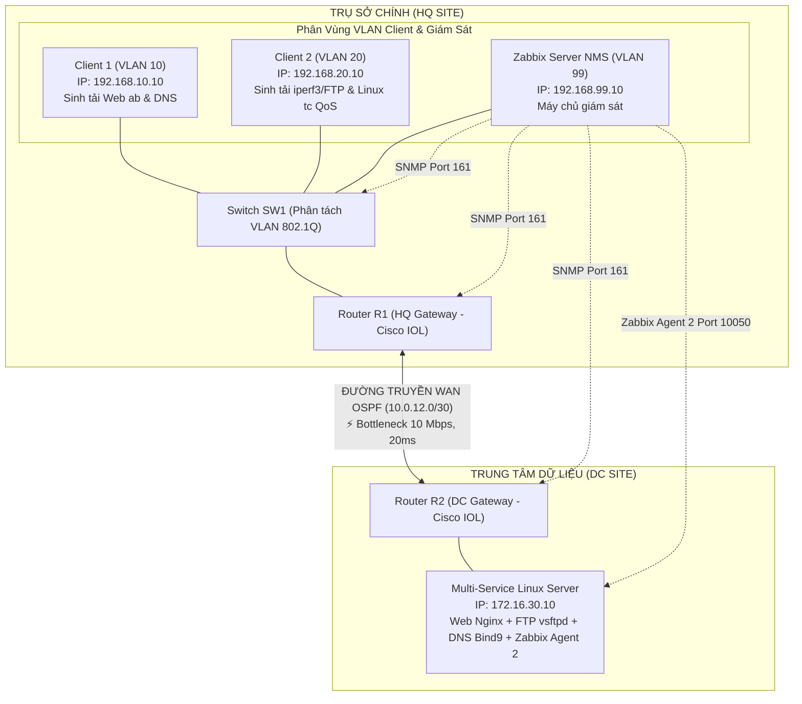

> [!IMPORTANT]
> **TÀI LIỆU HƯỚNG DẪN & KẾ HOẠCH TRIỂN KHAI ĐỒ ÁN NHÓM (BẢN TỐI ƯU HÓA)**
> Học phần: **Đánh giá hiệu năng mạng** (Bậc Đại học - Sinh viên năm 3 - Nhóm 6 thành viên).
> Toàn bộ cấu hình thiết bị, kịch bản sinh tải, file template giám sát và báo cáo mẫu được quản lý tập trung trong tài liệu này.

---

# HỆ THỐNG MẠNG DOANH NGHIỆP VỪA VÀ NHỎ & ĐÁNH GIÁ HIỆU NĂNG MẠNG ĐA DỊCH VỤ VỚI ZABBIX

> **Môn học / Đồ án:** Đánh giá hiệu năng mạng  
> **Đề tài:** Xây dựng mô hình mạng doanh nghiệp vừa và nhỏ trên PnetLab, sinh lưu lượng đa dịch vụ và đánh giá hiệu năng mạng bằng Zabbix  
> **Nền tảng kỹ thuật:** PnetLab (Cisco IOL, Alpine/Ubuntu Linux), Định tuyến OSPF / Static, 802.1Q VLAN, SNMPv2c, Zabbix 6.x/7.x & Zabbix Agent 2, iperf3, Apache Bench, fping, lftp, Linux `tc` / `netem`.

---

## 📑 MỤC LỤC
1. [Tổng Quan Đề Tài & Bối Cảnh Doanh Nghiệp](#1-tổng-quan-đề-tài--bối-cảnh-doanh-nghiệp)
2. [Mô Hình Kiến Trúc & Sơ Đồ Topology Tinh Gọn](#2-mô-hình-kiến-trúc--sơ-đồ-topology-tinh-gọn)
3. [Quy Hoạch Phân Vùng Mạng (VLAN & IP Addressing)](#3-quy-hoạch-phân-vùng-mạng-vlan--ip-addressing)
4. [Phân Chia Nhiệm Vụ 6 Thành Viên Theo Năng Lực](#4-phân-chia-nhiệm-vụ-6-thành-viên-theo-năng-lực)
5. [Ma Trận Trách Nhiệm Mới (RACI Matrix)](#5-ma-trận-trách-nhiệm-mới-raci-matrix)
6. [Kịch Bản Đo Kiểm & Demo Bảo Vệ Đồ Án (Test Cases)](#6-kịch-bản-đo-kiểm--demo-bảo-vệ-đồ-án-test-cases)
7. [Khung Đề Cương Báo Cáo Học Phần & Hướng Dẫn Soạn Thảo](#7-khung-đề-cương-báo-cáo-học-phần--hướng-dẫn-soạn-thảo)

---

## 1. TỔNG QUAN ĐỀ TÀI & BỐI CẢNH DOANH NGHIỆP

Trong các doanh nghiệp vừa và nhỏ (SME), hạ tầng mạng nội bộ thường xuyên phải xử lý đồng thời nhiều loại lưu lượng có mức độ ưu tiên và yêu cầu băng thông khác nhau:
* **Lưu lượng ứng dụng Web nghiệp vụ (HTTP/HTTPS):** Yêu cầu độ trễ thấp, thời gian tải trang nhanh để phục vụ công việc hàng ngày.
* **Lưu lượng truyền tệp tin dung lượng lớn (FTP):** Chiếm dụng băng thông cao, dễ gây đầy bộ đệm (Buffer Overflow) tại router/switch.
* **Lưu lượng phân giải tên miền (DNS) & Kiểm tra kết nối (ICMP):** Gói tin nhỏ nhưng nhạy cảm với tỷ lệ mất gói (Packet Loss) và biến động trễ (Jitter).
* **Lưu lượng quản trị và giám sát (SNMP, Zabbix Agent):** Cần thu thập liên tục để đánh giá trạng thái mạng mà không làm suy giảm hiệu năng chung.

**Mục tiêu của đồ án:**
1. Xây dựng mô hình mạng doanh nghiệp tinh gọn, hoạt động ổn định trên môi trường ảo hóa PnetLab.
2. Thiết lập hệ thống giám sát tập trung bằng Zabbix thông qua giao thức SNMP (trên Router/Switch) và Zabbix Agent 2 (trên Server dịch vụ).
3. Ứng dụng các công cụ sinh tải thực nghiệm (`ab`, `lftp`, `fping`, `iperf3`) để đo lường hiệu năng ở 2 trạng thái: **Bình thường (Baseline)** và **Quá tải nghẽn mạng (Stress Test)**.
4. Triển khai giải pháp tối ưu/QoS đơn giản bằng **Linux Traffic Control (`tc` / `netem`)** để chứng minh sự cải thiện rõ rệt về Throughput, Latency, Jitter và Packet Loss trong báo cáo.

---

## 2. MÔ HÌNH KIẾN TRÚC & SƠ ĐỒ TOPOLOGY TINH GỌN

Mô hình được tối ưu hóa tài nguyên (tổng RAM chỉ ~4GB – 6GB, phù hợp mọi laptop sinh viên) nhưng vẫn đảm bảo đầy đủ các phân vùng mạng và luồng dữ liệu cần đo kiểm:

```text
========================================================================================================================
                                             SƠ ĐỒ KIẾN TRÚC MẠNG & LUỒNG ĐO KIỂM
========================================================================================================================

   TRỤ SỞ CHÍNH (HQ SITE)                                                                  TRUNG TÂM DỮ LIỆU (DC SITE)
  ┌────────────────────────────────────────────────────────┐                              ┌─────────────────────────────┐
  │ [VLAN 10: 192.168.10.0/24]                             │                              │ [VLAN 30: 172.16.30.0/24]   │
  │  💻 Client 1 (192.168.10.10)                           │                              │  🏢 Multi-Service Server    │
  │     └─ Sinh tải Web (ab), DNS                          │                              │     IP: 172.16.30.10        │
  │                                                        │                              │     ├─ Nginx Web (Port 80)  │
  │ [VLAN 20: 192.168.20.0/24]                             │                              │     ├─ vsftpd FTP (Port 21) │
  │  💻 Client 2 (192.168.20.10)                           │                              │     ├─ Bind9 DNS (Port 53)  │
  │     ├─ Sinh tải nghẽn FTP, iperf3                      │                              │     └─ Zabbix Agent 2       │
  │     └─ ⚙️ Áp dụng Linux tc QoS Egress Shaper           │                              │        (Port 10050)         │
  │                                                        │                              └──────────────┬──────────────┘
  │ [VLAN 99: 192.168.99.0/24]                             │                                             │
  │  🖥️ Zabbix Server NMS (192.168.99.10)                  │                                             │
  │     └─ Giám sát tập trung (SNMP, Agent 2, ICMP)        │                                             │
  └────────────────────────┬───────────────────────────────┘                                             │
                           │ (Access / Trunk 802.1Q)                                                     │
  ┌────────────────────────┴───────────────────────────────┐                                             │
  │ 🔀 Switch SW1 (Cisco IOL Switch - Quản lý VLAN)       │                                             │
  └────────────────────────┬───────────────────────────────┘                                             │
                           │ (Trunk 802.1Q / Sub-interfaces)                                             │
  ┌────────────────────────┴───────────────────────────────┐                              ┌──────────────┴──────────────┐
  │ 🌐 Router R1 (HQ Gateway - Cisco IOL)                  │  ĐƯỜNG TRUYỀN WAN (OSPF A0)  │ 🌐 Router R2 (DC Gateway)   │
  │    IP: 10.0.12.1 / Sub-IF: .10, .20, .99               │◄════════════════════════════►│    IP: 10.0.12.2 / .30.1    │
  └────────────────────────────────────────────────────────┘ ⚡ BOTTLENECK: 10 Mbps, 20ms └─────────────────────────────┘
                                                               (PnetLab Link Quality)

  ──────────────────────────────────────────────────────────────────────────────────────────────────────────────────────
  📊 CÁC LUỒNG GIÁM SÁT ZABBIX (NMS):
     • [SNMPv2c Polling - Port 161]         : Zabbix Server ──► Router R1, Router R2, Switch SW1 (CPU, RAM, Traffic IF)
     • [Zabbix Agent 2 - Port 10050]        : Zabbix Server ──► Multi-Service Server (Web Nginx, FTP, System Metrics)
     • [ICMP Ping Polling / fping]          : Zabbix Server ──► R1, R2, SRV_MAIN (Đo Latency, Jitter, Packet Loss)
========================================================================================================================
```

<details>
<summary><b>📐 Xem mã nguồn sơ đồ dạng Mermaid (Click để mở)</b></summary>



</details>

> [!IMPORTANT]
> **NGUYÊN TẮC THIẾT KẾ BOTTLENECK & VỊ TRÍ ÁP DỤNG QOS CHUẨN MỰC:**
> 1. **Thiết lập Bottleneck WAN bằng Virtual Wire trên PnetLab:**
>    - **Tại sao KHÔNG dùng lệnh `bandwidth` trong Cisco IOS?** Trong Cisco IOS (IOL), lệnh `bandwidth <kbps>` trên interface chỉ là tham số logic để tính toán metric định tuyến (như OSPF cost), hoàn toàn **không thực hiện rate-limiting / traffic shaping vật lý**.
>    - **Giải pháp chính xác:** Dùng tính năng **Link Quality** ngay trên dây nối ảo R1↔R2 của PnetLab (Click vào đường nối giữa R1 và R2 -> Edit -> thiết lập *Bandwidth: 10 Mbps*, *Delay: 20ms*, *Loss: 0% / 0.1%*). Cơ chế này can thiệp trực tiếp vào Linux tap/bridge của PnetLab, tạo điểm thắt cổ chai (bottleneck) chuẩn xác 100% tại đường WAN.
> 2. **Chuẩn hóa vai trò các Node & Vị trí áp dụng Linux `tc` QoS (Chương 5):**
>    - **Chỉ sử dụng `Client 2` (tại HQ) để sinh tải nghẽn và áp `tc` Shaper:** Toàn bộ lưu lượng từ Client 2 đi đến `SRV_MAIN` bắt buộc phải băng qua R1 → WAN Bottleneck 10 Mbps → R2. Do đó, `Client 2` là vị trí chuẩn xác duy nhất để cấu hình `tc` Egress Shaper (HTB/Priority Queuing) điều tiết lưu lượng trước khi đổ vào thắt cổ chai WAN.
>    - **KHÔNG áp dụng trên Server đích (`SRV_MAIN`):** Việc áp `tc` bóp băng thông hay trễ trên Server đích sẽ biến Server thành điểm nghẽn cục bộ nhân tạo, làm sai lệch bản chất đo kiểm nghẽn đường truyền WAN.
>    - **Loại bỏ node phụ `CLI_STRESS` ở DC:** Vì nằm cùng phân vùng mạng với Server (sau R2), lưu lượng từ node này tới Server không đi qua liên kết WAN R1-R2 nên không tạo được nghẽn WAN. Việc loại bỏ node này giúp topology tinh gọn, tiết kiệm RAM lab và tránh nhầm lẫn khi đo kiểm/bảo vệ đồ án.

---

## 3. QUY HOẠCH PHÂN VÙNG MẠNG (VLAN & IP ADDRESSING)

| Phân Vùng Mạng | VLAN ID | Địa Chỉ Mạng (CIDR) | Default Gateway | Thiết Bị & Vai Trò Trong Đồ Án |
| :--- | :---: | :--- | :--- | :--- |
| **Quản Trị Giám Sát (NMS)** | VLAN 99 | `192.168.99.0/24` | `192.168.99.1` | Chứa máy chủ **Zabbix Server** (`.10`), giám sát toàn bộ hệ thống |
| **Văn Phòng - Web/DNS** | VLAN 10 | `192.168.10.0/24` | `192.168.10.1` | **Client 1** (`.10`): Sinh lưu lượng Web (`ab`) và phân giải DNS (`dig`/`nslookup`) |
| **Kỹ Thuật - FTP/iperf** | VLAN 20 | `192.168.20.0/24` | `192.168.20.1` | **Client 2** (`.10`): Sinh tải nặng FTP (`lftp`), `iperf3` và áp dụng **Linux `tc` QoS Egress Shaper** |
| **Server Farm (DC)** | VLAN 30 | `172.16.30.0/24` | `172.16.30.1` | **Multi-Service Server** (`.10`): Web Nginx + FTP vsftpd + DNS Bind9 + Zabbix Agent 2 |
| **Liên Kết WAN R1 - R2** | N/A | `10.0.12.0/30` | N/A | Đường truyền định tuyến OSPF kết nối R1 (`.1`) và R2 (`.2`). **Điểm nghẽn WAN (Bottleneck)** được giới hạn bởi PnetLab Link Quality (Bandwidth: 10 Mbps, Delay: 20ms) |

---

## 4. PHÂN CHIA NHIỆM VỤ 6 THÀNH VIÊN THEO NĂNG LỰC

Nhằm đảm bảo dự án hoàn thành đúng tiến độ, mọi thành viên đều có đóng góp rõ ràng và giáo viên chấm điểm công bằng, công việc được phân bổ theo 4 nhóm năng lực thực tế:

```
┌─────────────────────────────────────────────────────────────────────────────┐
│ 👑 THÀNH VIÊN 1                                      │
│ ➔ Phụ trách phần rủi ro & khó nhất: Giải pháp QoS / Traffic Shaping Linux   │
│ ➔ Phân tích số liệu đối chứng Trước/Sau, điều phối tiến độ, tổng hợp báo cáo│
├─────────────────────────────────────────────────────────────────────────────┤
│ 🌐 THÀNH VIÊN 2                                       │
│ ➔ Phụ trách hạ tầng cốt lõi: Topology PnetLab, OSPF, VLAN, SNMP             │
│ ➔ Cài đặt hệ thống giám sát Zabbix Server & tạo Dashboard trực quan         │
├──────────────────────────────────────┬──────────────────────────────────────┤
│ 🖥️ THÀNH VIÊN 3                      │ 🚀 THÀNH VIÊN 4    │
│ ➔ Cài đặt Multi-Service Server       │ ➔ Cài công cụ đo kiểm trên Client   │
│    (Web Nginx, FTP vsftpd, DNS)      │ ➔ Viết sẵn các Bash Script sinh tải  │
│ ➔ Cài đặt & cấu hình Zabbix Agent 2  │    (ab, lftp, fping, iperf3)         │
│ ➔ Kiểm tra Agent đẩy dữ liệu thành công│ ➔ Hướng dẫn TV5, TV6 cách bấm lệnh │
├──────────────────────────────────────┴──────────────────────────────────────┤
│ 📊 THÀNH VIÊN 5                          │ 📝 THÀNH VIÊN 6                   │
│ ➔ Chạy script sinh tải nghẽn mạng     │ ➔ Chạy kiểm thử đo độ trễ fping/DNS │
│    (iperf3 + ab) theo hướng dẫn      │ ➔ Chụp ảnh Dashboard Zabbix Before/After│
│ ➔ Trích xuất số liệu thô vào Excel   │ ➔ Viết nội dung lý thuyết tổng quan  │
│ ➔ Viết mô tả số liệu cho Chương 4    │    (Chương 1, Chương 2, Tài liệu TK) │
└─────────────────────────────────────────────────────────────────────────────┘
```

### Chi tiết nhiệm vụ và sản phẩm đầu ra của từng thành viên:

#### 👑 1. THÀNH VIÊN 1 (Nguyễn Anh Xuân: Phụ trách Tối ưu QoS, Phân tích & Tổng hợp)
* **Nhiệm vụ kỹ thuật:**
  1. Nghiên cứu và triển khai giải pháp điều tiết băng thông & QoS bằng **Linux `tc` (`Traffic Control`) / `netem`** trên node phát sinh tải nghẽn (**Client 2** tại phân vùng HQ) trước khi lưu lượng băng qua bottleneck WAN (áp dụng cấu trúc hàng đợi phân cấp **HTB** - Hierarchical Token Bucket kết hợp **Priority Queuing**).
  2. Cấu hình phân loại luồng (`tc filter`): Ưu tiên tối đa cho Web (HTTP port 80/443), DNS (UDP/TCP port 53) và ICMP; đồng thời bóp băng thông trần (rate-limit) đối với luồng tải nặng FTP / iperf3 để không làm nghẹt đường truyền WAN 10 Mbps.
  3. Thực hiện đo đạc đối chứng hiệu năng hệ thống ở trạng thái sau khi bật QoS/Tối ưu.
  4. Phân tích nguyên nhân suy thoái hiệu năng và cơ chế phục hồi chất lượng dịch vụ.
* **Nhiệm vụ báo cáo:** Phụ trách viết **Chương 5 (Đề xuất giải pháp và đánh giá cải thiện)**, Kết luận và chịu trách nhiệm rà soát, format chuẩn toàn bộ file Word/PDF nộp cho giảng viên.
* **Sản phẩm bàn giao:** Bộ script cấu hình Linux `tc`/QoS có chú thích; Nội dung Chương 5; File báo cáo hoàn chỉnh.

---

#### 🌐 2. THÀNH VIÊN 2 (Nguyễn Thành Đạt: Phụ trách Hạ tầng Mạng PnetLab & Zabbix Server)
* **Nhiệm vụ kỹ thuật:**
  1. Dựng sơ đồ mạng trên PnetLab: Cấu hình 2 Router Cisco (R1, R2), 1 Switch Cisco (SW1), cấu hình 802.1Q VLAN, Inter-VLAN Routing và định tuyến động OSPF Area 0.
  2. **Thiết lập Bottleneck WAN tầng ảo hóa:** Cấu hình tính năng **Link Quality** trực tiếp trên đường nối ảo giữa R1 và R2 trong giao diện PnetLab (Bandwidth: 10 Mbps, Delay: 20ms, Loss: 0%) để tạo điểm thắt cổ chai vật lý chuẩn xác thay vì dùng lệnh `bandwidth` logic của IOS.
  3. Kích hoạt SNMPv2c trên Router/Switch và mở ACL cho phép Zabbix Server thu thập metrics.
  4. Cài đặt hệ thống **Zabbix Server** (bản 6.x hoặc 7.x) kèm Web UI; tạo Host, gắn Template SNMP và thiết kế Dashboard tổng quan.
* **Nhiệm vụ báo cáo:** Phụ trách viết **Mục 3.1, 3.2, 3.3, 3.4** (Sơ đồ topology, Bảng IP/VLAN, Thiết lập Link Quality PnetLab, Lệnh cấu hình Router/Switch, Cài đặt Zabbix Server) và Phụ lục cấu hình mạng.
* **Sản phẩm bàn giao:** File Lab PnetLab thông suốt có sẵn điểm nghẽn WAN 10 Mbps; Máy chủ Zabbix Server sẵn sàng nhận dữ liệu; Các mục báo cáo phụ trách.

---

#### 🖥️ 3. THÀNH VIÊN 3 (Nguyễn Phúc Vượng: Phụ trách Cụm Dịch Vụ Server & Zabbix Agent)
* **Nhiệm vụ kỹ thuật:**
  1. Cài đặt máy chủ Linux đa dịch vụ (Multi-Service Server): Web Server (Nginx), FTP Server (vsftpd) và DNS Server (Bind9). Chuẩn bị sẵn file dữ liệu mẫu (50MB, 100MB) để test FTP.
  2. Cài đặt và cấu hình **Zabbix Agent 2** trên Server dịch vụ; cấu hình file `zabbix_agentd.conf` để đẩy dữ liệu CPU, RAM, Disk I/O, Network Traffic về Zabbix Server.
  3. Kiểm tra trạng thái kết nối giữa Server và Zabbix Server, đảm bảo biểu đồ Zabbix Agent hiển thị màu xanh (Active).
* **Nhiệm vụ báo cáo:** Phụ trách viết **Mục 2.3** (Tổng quan PnetLab & Ảo hóa) và phần cấu hình Server/Agent trong **Mục 3.4**.
* **Sản phẩm bàn giao:** Multi-Service Server hoạt động đầy đủ 3 dịch vụ; Zabbix Agent gửi metrics ổn định; Nội dung báo cáo phần Server.

---

#### 🚀 4. THÀNH VIÊN 4 (Nguyễn Minh Trí: Phụ trách Kịch bản Sinh tải & Đo kiểm Baseline)
* **Nhiệm vụ kỹ thuật:**
  1. Cài đặt các công cụ đo kiểm trên các node Client (`apache2-utils`, `lftp`, `fping`, `iperf3`).
  2. Viết sẵn các **Bash Script sinh tải tự động** (Script chạy `ab` tạo 5,000–10,000 requests, Script `lftp` tải file lặp lại, Script `iperf3` tạo tải nghẽn).
  3. Hướng dẫn chi tiết cho TV 5 và TV 6 cách thức bấm chạy các script và đọc kết quả terminal.
  4. Thực hiện chạy đo kiểm trạng thái cơ sở ban đầu (**Baseline Measurement**) khi hệ thống chưa có tải nặng.
* **Nhiệm vụ báo cáo:** Phụ trách viết **Mục 2.1, 2.2** (Khái niệm và các chỉ số hiệu năng: Throughput, Latency, Jitter, Packet Loss) và **Mục 3.5** (Kịch bản sinh lưu lượng chi tiết).
* **Sản phẩm bàn giao:** Bộ script sinh tải `.sh` có sẵn; Số liệu đo kiểm Baseline; Nội dung các mục báo cáo lý thuyết & kịch bản.

---

#### 📊 5. THÀNH VIÊN 5 (Lê Tuấn Anh: Thực thi Đo kiểm Nghẽn mạng & Thu thập Số liệu)
* **Nhiệm vụ thực hiện:**
  1. Nhận các bash script sinh tải từ TV 4, tiến hành bấm lệnh chạy kịch bản tạo tải nghẽn mạng (**Stress Test**) bằng `iperf3` kết hợp `ab` và `lftp`.
  2. Theo dõi giao diện Dashboard Zabbix trong quá trình sinh tải, chụp lại ảnh màn hình các biểu đồ (Bandwidth bão hòa, Latency tăng vọt, Packet loss xuất hiện).
  3. Ghi chép toàn bộ số liệu đo được (Throughput, Ping RTT, Request/sec, CPU Server) vào file bảng tính Excel để đối chứng.
* **Nhiệm vụ báo cáo:** Phụ trách viết phần mô tả số liệu và lập bảng tổng hợp kết quả đo kiểm trong **Chương 4 (Kết quả thực nghiệm và đánh giá hiệu năng)** theo khung có sẵn.
* **Sản phẩm bàn giao:** File Excel tổng hợp số liệu đo kiểm Baseline vs High Load; Kho ảnh chụp màn hình Zabbix sắc nét; Bản nháp bảng biểu Chương 4.

---

#### 📝 6. THÀNH VIÊN 6 (Kiều Đức Dương: Đo kiểm Độ trễ, Chụp ảnh Minh chứng & Viết Lý thuyết)
* **Nhiệm vụ thực hiện:**
  1. Thực hiện các lệnh đo lặp lại đơn giản: Chạy `fping` đo độ trễ liên tục và truy vấn `dig`/`nslookup` kiểm tra phản hồi của DNS Server trước và sau khi nghẽn mạng.
  2. Chụp ảnh màn hình minh chứng kết quả đo kiểm trên terminal Client và ảnh Dashboard Zabbix sau khi Trưởng nhóm (TV 1) áp dụng giải pháp QoS.
  3. Hỗ trợ tìm kiếm tài liệu, chuẩn hóa danh mục tài liệu tham khảo và định dạng bảng biểu.
* **Nhiệm vụ báo cáo:** Phụ trách viết **Chương 1 (Giới thiệu tổng quan, Lý do chọn đề tài, Mục tiêu, Phạm vi)**, **Mục 2.4, 2.5 (Tổng quan Zabbix & So sánh Zabbix với Cacti/PRTG)** và phần Danh mục tài liệu tham khảo.
* **Sản phẩm bàn giao:** Ảnh chụp terminal kiểm thử; Nội dung hoàn chỉnh của Chương 1, Mục 2.4, 2.5 và Danh mục tài liệu tham khảo chuẩn IEEE/APA.

---

## 5. MA TRẬN TRÁCH NHIỆM MỚI (RACI MATRIX)

| Hạng mục công việc trong đồ án | TV 1 | TV 2 | TV 3 | TV 4 | TV 5 | TV 6 |
| :--- | :---: | :---: | :---: | :---: | :---: | :---: |
| 1. Dựng Topology PnetLab, cấu hình OSPF, VLAN & SNMP | I | **R / A** | C | C | I | I |
| 2. Cài đặt Multi-Service Server & Cấu hình Zabbix Agent 2 | I | C | **R / A** | C | I | I |
| 3. Cài đặt Zabbix Server, thiết lập Items & Dashboard | **A** | **R** | C | I | I | C |
| 4. Viết script sinh tải tự động (ab, lftp, fping, iperf3) | I | I | C | **R / A** | C | C |
| 5. Chạy đo đạc trạng thái cơ sở bình thường (Baseline) | I | I | C | **R / A** | C | C |
| 6. Thực thi kịch bản tạo nghẽn iperf3 & lấy số liệu High Load | I | I | I | C | **R / A** | C |
| 7. Chạy kiểm tra độ trễ fping/DNS & chụp ảnh Dashboard | I | I | I | I | C | **R / A** |
| 8. Cấu hình giải pháp QoS (Linux `tc`/`netem`) & đo kiểm đối chứng | **R / A** | C | I | I | C | I |
| 9. Viết Chương 1, Chương 2 (Lý thuyết, So sánh công cụ) | **A** | I | C | C | I | **R** |
| 10. Viết Chương 3 (Thiết kế & Triển khai) | **A** | **R** | **R** | **R** | I | I |
| 11. Viết Chương 4 (Số liệu đo đạc & Phân tích nghẽn) | **A** | I | I | C | **R** | C |
| 12. Viết Chương 5 (Giải pháp cải thiện & Tối ưu QoS) | **R / A** | C | I | I | I | I |
| 13. Tổng hợp Báo cáo Word, Slide thuyết trình & Nghiệm thu | **R / A** | C | C | C | C | **R** |

> **Quy ước:** **R** = Người trực tiếp làm; **A** = Người kiểm tra/nghiệm thu; **C** = Người hỗ trợ; **I** = Người nắm thông tin.

---

## 6. KỊCH BẢN ĐO KIỂM & DEMO BẢO VỆ ĐỒ ÁN (TEST CASES)

Các Test Case được thiết kế dễ thực hiện, đo đạc đầy đủ các chỉ số hiệu năng phục vụ trực tiếp cho Chương 4 và Chương 5 của báo cáo:

| Mã TC | Tên Kịch Bản Đo Kiểm | Thao Tác & Lệnh Thực Thi | Chỉ Số Thu Thập Được Trên Zabbix / Terminal | Người Thực Hiện |
| :---: | :--- | :--- | :--- | :---: |
| **TC-01** | Đo hiệu năng trạng thái cơ sở (**Baseline**) | Chạy tải nhẹ Web (`ab -n 500 -c 5`) và FTP bình thường | Throughput WAN: 1–2 Mbps, Latency RTT < 5ms, Packet Loss = 0%, CPU Server < 10% | TV 4 (Hỗ trợ: TV 5) |
| **TC-02** | Đo hiệu năng dịch vụ Web khi tăng tải | Chạy `ab -n 10000 -c 50 http://172.16.30.10/` từ Client 1 | Số Request/sec xử lý được, thời gian phản hồi trang (Web Response Time), CPU Web Server | TV 4, TV 5 |
| **TC-03** | Đo tốc độ truyền tệp FTP | Chạy script `lftp` tải liên tục tệp 100MB từ Client 2 | Tốc độ truyền tải FTP (KB/s), Băng thông giao diện mạng, Disk I/O Server | TV 5, TV 3 |
| **TC-04** | Kích hoạt nghẽn mạng bằng `iperf3` (**Stress Test**) | Trên Client 2 chạy `iperf3 -c 172.16.30.10 -u -b 20M -t 120` (vượt quá trần 10 Mbps của link WAN R1-R2) | Băng thông WAN bão hòa 100% (chạm trần 10 Mbps), Packet Loss tăng lên 15–30%, Jitter tăng mạnh | TV 5 (Hỗ trợ: TV 4) |
| **TC-05** | Đo sự suy giảm chất lượng Web/DNS khi nghẽn | Chạy `ab` và `fping -c 100 172.16.30.10` trong lúc `iperf3` đang chạy | Web response time tăng gấp 20–40 lần, xuất hiện HTTP Timeout, Ping RTT tăng vọt từ 4ms lên 150–300ms | TV 5, TV 6 |
| **TC-06** | Áp dụng giải pháp điều tiết băng thông (**Linux `tc` QoS**) | Chạy script `tc` trên **Client 2 (HQ)**: ưu tiên hàng đợi Web/DNS (port 80/53) và bóp trần iperf3/FTP | Lưu lượng Web và DNS được chuyển vào hàng đợi ưu tiên cao, iperf3 bị giới hạn trần, giải phóng hàng đợi WAN | TV 1 (Trưởng nhóm) |
| **TC-07** | Đánh giá hiệu quả phục hồi mạng sau tối ưu | Chạy đồng thời `iperf3` + `ab` sau khi đã kích hoạt `tc` QoS tại node Client 2 | Đồ thị Zabbix hiển thị: Ping RTT giảm từ 250ms về < 25ms, Web Request/s phục hồi 80–90%, Loss = 0% cho Web | TV 1, TV 6 |

---

## 7. KHUNG ĐỀ CƯƠNG BÁO CÁO HỌC PHẦN & HƯỚNG DẪN SOẠN THẢO

Cấu trúc đề cương chuẩn theo mẫu báo cáo học phần Đại học, mỗi mục kèm 3-5 gạch đầu dòng hướng dẫn chi tiết để các thành viên viết song song:

### 📘 PHẦN 1: MỞ ĐẦU & CƠ SỞ LÝ THUYẾT

#### CHƯƠNG 1: GIỚI THIỆU TỔNG QUAN ĐỀ TÀI *(Phụ trách: TV 6, SV 1 duyệt)*
* **1.1. Lý do chọn đề tài:**
  - Nêu tầm quan trọng của việc đánh giá hiệu năng mạng trong các doanh nghiệp SME khi vận hành nhiều dịch vụ đồng thời.
  - Vấn đề tắc nghẽn tài nguyên đường truyền khi có các luồng dữ liệu lớn (FTP, download) chèn ép ứng dụng quan trọng (Web, DNS).
  - Vai trò của các công cụ giám sát thời gian thực (Zabbix) trong việc phát hiện sớm sự cố và đo lường SLA/QoS.
* **1.2. Mục tiêu nghiên cứu:**
  - Nắm vững phương pháp luận đánh giá hiệu năng mạng IP theo các tiêu chuẩn quốc tế.
  - Xây dựng thành công mô hình mạng doanh nghiệp ảo hóa trên PnetLab và triển khai hệ thống giám sát Zabbix.
  - Thực hiện các kịch bản sinh tải thực nghiệm, đo lường định lượng và kiểm chứng giải pháp cải thiện hiệu năng.
* **1.3. Phạm vi và đối tượng nghiên cứu:**
  - *Đối tượng:* Các chỉ số Throughput, Latency, Jitter, Packet Loss, CPU/RAM Server và cơ chế điều tiết luồng dữ liệu.
  - *Phạm vi:* Mô hình mạng lab ảo hóa trên PnetLab gồm 2 Router Cisco (R1, R2), 1 Switch Cisco (SW1), 1 Multi-Service Server, 1 Zabbix Server và 2 Client (Client 1, Client 2).
* **1.4. Phương pháp nghiên cứu:**
  - Phương pháp nghiên cứu tài liệu lý thuyết (RFC 2544, ITU-T Y.1541).
  - Phương pháp thực nghiệm mô phỏng và phân tích đối chứng hai trạng thái (Baseline vs High Load có/không QoS).

#### CHƯƠNG 2: CƠ SỞ LÝ THUYẾT VỀ HIỆU NĂNG MẠNG VÀ CÔNG CỤ *(Phụ trách: TV 4, TV 6)*
* **2.1. Khái niệm hiệu năng mạng và chất lượng dịch vụ (QoS/QoE):**
  - Định nghĩa hiệu năng mạng, phân biệt giữa QoS (thông số kỹ thuật) và QoE (trải nghiệm người dùng cuối).
  - Các nguyên nhân chính gây suy giảm hiệu năng: Trễ truyền dẫn, trễ xếp hàng (Queuing Delay), hiện tượng bão hòa băng thông.
* **2.2. Các chỉ số đánh giá hiệu năng cốt lõi:**
  - *Throughput & Bandwidth:* Định nghĩa, công thức tính toán và sự khác biệt giữa Throughput và Goodput.
  - *Latency (Độ trễ) & Jitter (Biến động trễ):* Các thành phần của trễ mạng, khái niệm Round Trip Time (RTT) và công thức tính Jitter.
  - *Packet Loss (Mất gói):* Nguyên nhân gây mất gói (tràn hàng đợi buffer) và mức độ ảnh hưởng đến giao thức TCP/UDP.
  - *Chỉ số tài nguyên Server:* Tỷ lệ CPU, RAM, Disk I/O và số lượng Concurrent Connections.
* **2.3. Tổng quan nền tảng mô phỏng PnetLab & Kỹ thuật tạo Bottleneck:**
  - Giới thiệu PnetLab, kiến trúc KVM/QEMU chạy hệ điều hành mạng thật (Cisco IOL, Linux Server).
  - Ưu điểm của PnetLab so với Packet Tracer (hỗ trợ OS thật, cho phép cài đặt Web/DNS/Zabbix thật).
  - **Phân tích cơ chế Virtual Wire Link Quality:** So sánh tính năng giới hạn băng thông/độ trễ trực tiếp trên dây nối ảo PnetLab (can thiệp Linux tap/bridge thực thụ) với lệnh `bandwidth` trong Cisco IOS (chỉ mang ý nghĩa logic tính metric OSPF, không có khả năng rate-limit vật lý).
* **2.4. Tổng quan hệ thống giám sát Zabbix:**
  - Kiến trúc thành phần: Zabbix Server, Zabbix Database, Web Frontend và Zabbix Agent.
  - Phương thức thu thập dữ liệu: SNMP Polling (cho thiết bị mạng) và Agent Active/Passive (cho máy chủ).
* **2.5. So sánh Zabbix với Cacti và PRTG:**
  - Lập bảng so sánh theo các tiêu chí: Chi phí, tính năng giám sát máy chủ, khả năng cảnh báo, giao diện trực quan.
  - Lý do lựa chọn Zabbix: Miễn phí mã nguồn mở, hỗ trợ giám sát toàn diện cả thiết bị mạng lẫn ứng dụng.

---

### 🛠️ PHẦN 2: THIẾT KẾ, TRIỂN KHAI VÀ THỰC NGHIỆM

#### CHƯƠNG 3: THIẾT KẾ VÀ TRIỂN KHAI HỆ THỐNG MẠNG TRÊN PNETLAB *(Phụ trách: TV 2, TV 3, TV 4)*
* **3.1. Sơ đồ kiến trúc mạng (Topology) & Thiết lập Bottleneck:**
  - Mô tả chi tiết sơ đồ mạng tinh gọn gồm Trụ sở chính (HQ) và Trung tâm dữ liệu (DC).
  - Giải thích chức năng của từng thiết bị trong mô hình mạng.
  - **Cấu hình Link Quality PnetLab:** Thiết lập thông số đường truyền WAN R1-R2 (Bandwidth 10 Mbps, Delay 20ms) tạo thắt cổ chai chuẩn xác.
* **3.2. Quy hoạch IP và phân vùng VLAN:**
  - Trình bày bảng phân bổ địa chỉ IP, Default Gateway và các phân vùng VLAN 10, VLAN 20, VLAN 99, VLAN 30.
  - Giải thích lý do cô lập vùng giám sát NMS (VLAN 99) khỏi các vùng người dùng.
* **3.3. Cấu hình thiết bị mạng (Router & Switch):**
  - Cấu hình VLAN, Trunking 802.1Q và Inter-VLAN Routing trên Switch SW1 và Router R1.
  - Cấu hình giao thức định tuyến OSPF Area 0 trên liên kết WAN giữa R1 và R2.
  - Cấu hình SNMPv2c trên Router R1, R2 và Switch SW1 để cho phép Zabbix thu thập thông số interface.
* **3.4. Cài đặt và cấu hình hệ thống giám sát & Máy chủ dịch vụ:**
  - Cài đặt Zabbix Server, thiết lập Host giám sát cho Router/Switch qua SNMP Template.
  - Cài đặt Multi-Service Server (Nginx, vsftpd, Bind9) và cấu hình Zabbix Agent 2 đẩy dữ liệu về Zabbix Server.
  - Thiết kế Dashboard Zabbix tổng quan theo dõi lưu lượng mạng, độ trễ và tài nguyên máy chủ.
* **3.5. Xây dựng kịch bản sinh lưu lượng đa dịch vụ:**
  - Kịch bản Web: Sử dụng Apache Bench (`ab`) gửi hàng loạt requests đồng thời từ Client 1.
  - Kịch bản FTP: Sử dụng `lftp` tải lên/xuống các file dữ liệu lớn liên tục từ Client 2.
  - Kịch bản đo độ trễ: Sử dụng `fping` lấy mẫu liên tục với chu kỳ ngắn từ Client 1/Client 2.
  - Kịch bản tạo nghẽn: Sử dụng `iperf3` chạy từ Client 2 tạo luồng UDP 20 Mbps vượt ngưỡng băng thông WAN 10 Mbps để kích hoạt nghẽn.

#### CHƯƠNG 4: KẾT QUẢ THỰC NGHIỆM VÀ ĐÁNH GIÁ HIỆU NĂNG *(Phụ trách: TV 5, TV 1, TV 4)*
* **4.1. Quy trình thực nghiệm đo kiểm:**
  - Trình bày các bước chuẩn bị: Đồng bộ thời gian NTP, kiểm tra trạng thái thông mạng, đưa lab về trạng thái rỗi.
  - Mô tả tiến trình đo ở 2 giai đoạn: Đo cơ sở (Baseline) và Đo khi quá tải (Stress Test).
* **4.2. Bảng tổng hợp số liệu đo đạc thực nghiệm:**
  - Lập bảng so sánh chi tiết trước và sau khi sinh tải nghẽn: Throughput, Ping RTT, Jitter, Packet Loss, Web Response Time, CPU/RAM Server.
  - Tính toán tỷ lệ phần trăm suy thoái hiệu năng của từng chỉ số.
* **4.3. Phân tích chi tiết qua biểu đồ giám sát Zabbix:**
  - Phân tích biểu đồ lưu lượng cổng mạng WAN khi bị `iperf3` chiếm dụng kịch trần 10 Mbps.
  - Phân tích biểu đồ ICMP Response Time và tỷ lệ mất gói tương ứng khi mạng đầy tải.
  - Phân tích biểu đồ tải CPU/RAM của Web Server khi số lượng kết nối đồng thời tăng cao.
* **4.4. Nhận xét và đánh giá nguyên nhân suy thoái hiệu năng:**
  - Đánh giá hiện tượng tranh chấp tài nguyên giữa luồng truyền file lớn (FTP/iperf3) và ứng dụng Web/DNS tại nút thắt WAN.
  - Xác định nguyên nhân chính: Đường truyền thiếu cơ chế phân loại hàng đợi và điều tiết băng thông ưu tiên tại nguồn phát (Client 2) trước khi vào đường WAN.

---

### 🚀 PHẦN 3: TỐI ƯU HÓA, KẾT LUẬN VÀ PHỤ LỤC

#### CHƯƠNG 5: ĐỀ XUẤT GIẢI PHÁP VÀ ĐÁNH GIÁ CẢI THIỆN *(Phụ trách: TV 1 - Trưởng nhóm)*
* **5.1. Đề xuất giải pháp điều tiết băng thông & QoS bằng Linux `tc`:**
  - **Kiến trúc & Vị trí triển khai QoS chuẩn xác:** Lý giải vì sao áp dụng Linux `tc` / `netem` trực tiếp tại **Client 2 (HQ)** trước khi lưu lượng đi vào đường truyền WAN 10 Mbps thay vì áp trên Server đích (`SRV_MAIN`) (tránh biến Server thành bottleneck giả tạo và giữ đúng bản chất bài toán nghẽn đường truyền WAN).
  - **Nguyên lý hoạt động:** Giới thiệu cơ chế Token Bucket Filter (`tbf`), hàng đợi phân cấp **HTB** (Hierarchical Token Bucket) và bộ lọc phân loại luồng (`tc filter` match theo cổng dịch vụ).
  - **Bộ lệnh cấu hình chi tiết:**
    - Tạo Root Qdisc HTB và định nghĩa các Class băng thông (Class ưu tiên Web/DNS port 80/443/53; Class giới hạn trần FTP/iperf3 port 21/5001 dưới 6 Mbps).
    - Cấu hình `prio` / `pfifo` để ưu tiên đẩy gói Web/DNS đi trước khi có nghẽn.
* **5.2. Giải pháp tinh chỉnh cấu hình máy chủ (Server Tuning):**
  - Tinh chỉnh tham số TCP Stack trong Linux Kernel (`sysctl.conf`) để tăng khả năng chịu tải kết nối.
  - Cấu hình tối ưu Nginx (Keepalive, Gzip compression) nhằm giảm kích thước truyền tải.
* **5.3. Kết quả thực nghiệm đối chứng sau cải thiện:**
  - Lập bảng số liệu so sánh 3 trạng thái: *Trạng thái bình thường* vs *Trạng thái nghẽn chưa có QoS* vs *Trạng thái nghẽn đã có QoS*.
  - Trích xuất biểu đồ Zabbix chứng minh: Độ trễ Web/DNS giảm mạnh từ >200ms về <25ms, không còn hiện tượng mất gói dịch vụ quan trọng dù kênh truyền vẫn đầy tải.
* **5.4. Đánh giá tính khả thi và phạm vi ứng dụng trong thực tế:**
  - Đánh giá tính ứng dụng của giải pháp trong các doanh nghiệp SME có ngân sách đầu tư thiết bị hạn chế.

#### KẾT LUẬN VÀ HƯỚNG PHÁT TRIỂN *(Phụ trách: TV 1, TV 6)*
* **1. Các kết quả đã đạt được của đồ án:**
  - Hoàn thành đầy đủ việc mô phỏng mạng doanh nghiệp, sinh tải đa dịch vụ và giám sát định lượng bằng Zabbix.
  - Chứng minh thành công hiệu quả của giải pháp điều tiết băng thông/QoS bằng số liệu thực nghiệm rõ ràng.
* **2. Những hạn chế còn tồn tại:**
  - Quy mô lab ảo hóa còn ở mức cơ bản, chưa mô phỏng các dịch vụ thoại (VoIP) hoặc video stream thời gian thực.
* **3. Hướng phát triển tiếp theo:**
  - Nghiên cứu mở rộng mô hình đa chi nhánh với VPN IPsec và tích hợp thêm công cụ phân tích luồng chuyên sâu (NetFlow / sFlow).

#### TÀI LIỆU THAM KHẢO & PHỤ LỤC *(Phụ trách: Cả nhóm)*
* **Tài liệu tham khảo:** Trình bày theo chuẩn IEEE/APA (Tài liệu Zabbix Documentation, RFC 2544, Linux tc man page, Giáo trình Mạng máy tính).
* **Phụ lục A:** Toàn bộ lệnh cấu hình Router Cisco R1, R2 và Switch SW1 (OSPF, VLAN, SNMP).
* **Phụ lục B:** File cấu hình Zabbix Agent 2 (`zabbix_agentd.conf`) và cấu hình dịch vụ Nginx/FTP/DNS.
* **Phụ lục C:** Toàn bộ mã nguồn Bash Script sinh tải (`traffic_stress.sh`, `web_test.sh`, `ftp_test.sh`).
* **Phụ lục D:** Toàn bộ script cấu hình Linux `tc` HTB/QoS phân luồng ưu tiên.
* **Phụ lục E:** Bảng trích xuất số liệu đo kiểm thô (Raw Data) từ Zabbix Database.

---

> [!TIP]
> **KỊCH BẢN 3 BƯỚC DEMO BẢO VỆ ĐỒ ÁN TRƯỚC HỘI ĐỒNG:**
> 1. **Bước 1 (Trạng thái bình thường):** Mở Dashboard Zabbix, cho thầy cô thấy đường truyền WAN 10 Mbps xanh, độ trễ ICMP thấp (< 5ms).
> 2. **Bước 2 (Gây nghẽn mạng qua PnetLab WAN Bottleneck):** Bấm chạy script `iperf3` (20 Mbps) từ Client 2 và `ab` từ Client 1 -> Chỉ cho thầy cô thấy trên Dashboard Zabbix: Lưu lượng WAN vọt lên kịch trần 10 Mbps, Ping RTT nhảy vọt lên 200–300ms, Web tải rất chậm do nghẽn tại đường truyền WAN ảo của PnetLab.
> 3. **Bước 3 (Bật giải pháp tối ưu `tc` QoS tại node Client 2):** Kích hoạt script cấu hình Linux `tc` QoS trên **Client 2 (HQ)** -> Chỉ cho thầy cô thấy ngay lập tức trên biểu đồ Zabbix: Độ trễ Web/Ping hạ gục về mức bình thường (< 25ms), dịch vụ Web mượt trở lại dù `iperf3` vẫn đang chạy nền vì lưu lượng đã được điều tiết trước khi vào thắt cổ chai WAN.
